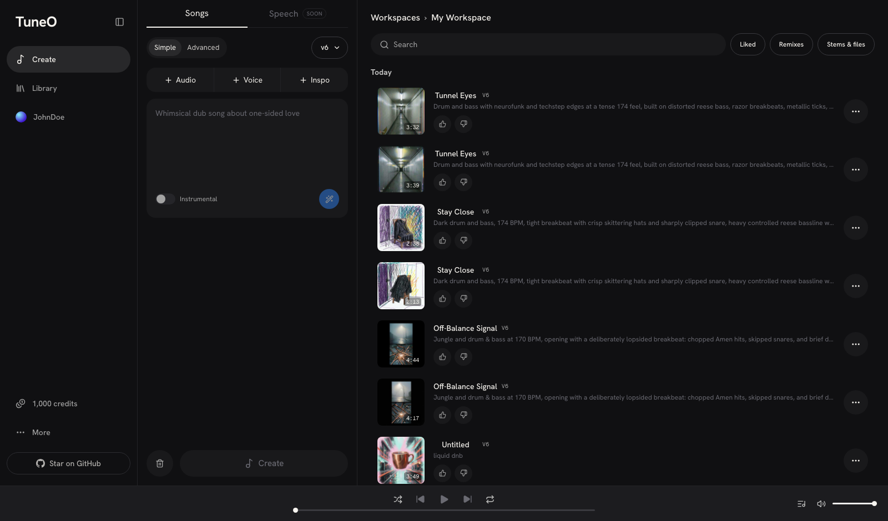
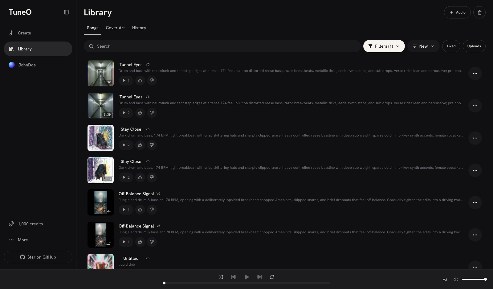
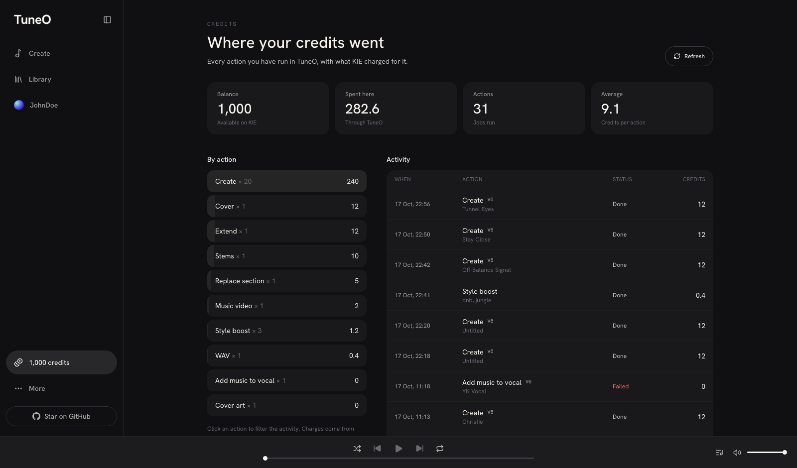
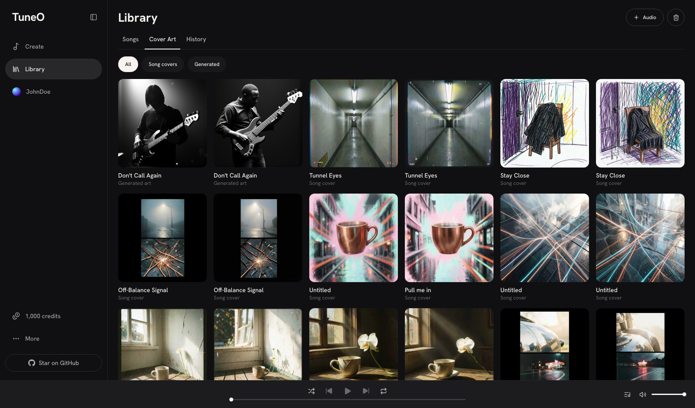
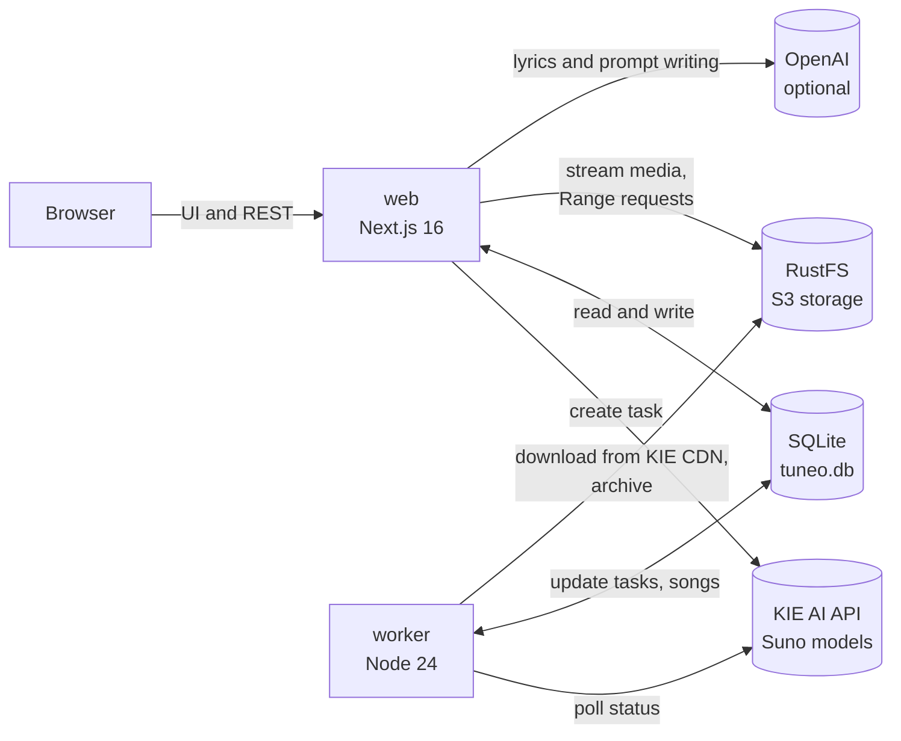
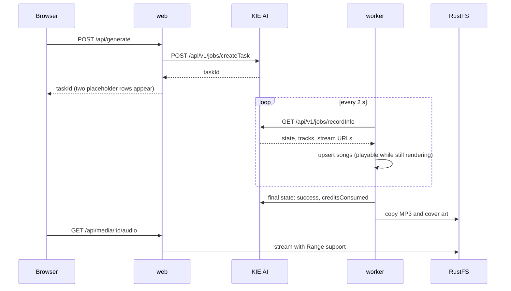

<div align="center">

# TuneO

### The open-source, self-hosted AI music studio. A Suno alternative you run on your own machine.

Create full songs with vocals, write and arrange lyrics with AI, remix, extend, split stems, make custom voices and keep every file forever, all from one Docker Compose stack powered by the **KIE AI Suno API**.

[](LICENSE)


-orange>)

[Features](#features) · [How it works](#how-it-works) · [KIE AI Suno API](#how-tuneo-uses-the-kie-ai-suno-api) · [Quick start](#quick-start) · [Configuration](#configuration) · [Legal](#legal) · [License](#license)



</div>

---

## What is TuneO?

**TuneO is a free, open-source Suno clone for personal use**: a complete AI music generator web app you host yourself. It recreates the familiar create, remix and library workflow of hosted AI music tools, but your songs, covers, stems, videos, voices and settings live on **your** storage, not someone else's feed.

Generation runs through the [KIE AI](https://kie.ai) music API, which serves the Suno model family (v6, v6-mini and v6-wild) over a simple pay-as-you-go REST API. You bring a KIE API key, TuneO handles everything else: the studio interface, the job pipeline, archiving, metadata, credit tracking and playback.

If you searched for an **open-source Suno alternative**, a **Suno API web UI**, a **self-hosted AI song generator** or a **Suno clone on GitHub**, this is it.

**Why it exists**

- **Ownership.** KIE deletes generated media after 14 days. TuneO copies every finished track, cover, stem and video into your own S3-compatible storage the moment it is ready, so nothing expires.
- **No lost work.** A background worker follows every generation to completion. Close the tab, restart the browser, come back tomorrow: the songs are there.
- **Transparency.** Every credit spent is recorded from KIE's own charge records and shown on a dedicated Credits page.
- **Hackability.** One small TypeScript codebase, one SQLite file, one storage bucket. Easy to read, easy to extend.

> TuneO is an independent, open-source community project. It is not affiliated with, endorsed by or sponsored by Suno, Inc. or KIE AI. See [Legal](#legal).

---

## Table of contents

- [Features](#features)
- [Screenshots](#screenshots)
- [How it works](#how-it-works)
- [How TuneO uses the KIE AI Suno API](#how-tuneo-uses-the-kie-ai-suno-api)
- [AI lyric and prompt writing](#ai-lyric-and-prompt-writing)
- [Tech stack](#tech-stack)
- [Quick start](#quick-start)
- [Configuration](#configuration)
- [Security](#security)
- [Local development](#local-development)
- [Project structure](#project-structure)
- [Data, storage and backups](#data-storage-and-backups)
- [Costs](#costs)
- [Troubleshooting](#troubleshooting)
- [Roadmap](#roadmap)
- [Contributing](#contributing)
- [Legal](#legal)
- [License](#license)
- [Acknowledgements](#acknowledgements)

---

## Features

### Create

- **Simple mode**: describe a song in a sentence and get two full takes with AI-written lyrics.
- **Magic wand**: rewrites a short idea into a compact, genre-first prompt (genre, mood, BPM, instruments, vocal, topic) within the ideal length for the model.
- **Advanced mode**: your own lyrics, styles, title and fine controls for **weirdness**, **style influence**, **variety**, **duration**, **vocal gender** and excluded styles.
- **Style boost**: enrich a short style into a detailed production brief.
- **Pro lyric writer**: drafts or rewrites lyrics as a full arrangement map with section tags, modifiers, delivery cues, ad-libs and dynamics (see [below](#ai-lyric-and-prompt-writing)).
- **Model picker**: v6 (default, most natural vocals), v6-wild (experimental) and v6-mini (fast).
- **Attachments**: record or upload audio, add up to five reference images.

### Remix and edit

- **Cover** a song in a new style, **Extend** it from any point, **Replace Section** to rewrite part of a song.
- **Add Instrumental**: keep your recorded vocal exactly as sung and build the music around it.
- **Reuse Prompt** to start a new song from an existing one.
- Works on generated songs and on audio you upload.

### Voices

- **Custom voices**: record or upload a sample, sing back a verification phrase, and use the voice in new songs.
- **Voices from a song**: turn any song you made into a reusable voice and style.
- **Voice influence** slider to control how strongly a voice shapes the vocals.
- Preview each voice from its thumbnail.

### Library and playback

- Library with **search**, **filters** (liked, disliked, uploads, covers, edits, downloads), **sorting** (newest, oldest, most liked, most played) and **play counts**.
- **Cover Art** gallery, **History** of what you played and a **Trash** with restore and permanent delete.
- Persistent **player** with queue panel, shuffle, repeat, seek and keyboard control.
- **Song details** drawer with editable title, metadata, lineage and **synced karaoke lyrics**.

### Files and downloads

- **MP3** downloads tagged with title, artist, album, year, genre, lyrics and embedded cover art (ID3v2.3).
- **WAV** export, **stems** (vocals and instrumental), **music video** (MP4) and generated **cover art**.

### Ownership and transparency

- Automatic archiving of all media to RustFS (S3 compatible).
- **Credits** page with balance, spend per action and a full activity log from KIE's charge records.
- Global **artist name** applied to the player, details, video signature and file tags.

---

## Screenshots

| Create                                                                                                  | Library                                                                                         |
| ------------------------------------------------------------------------------------------------------- | ----------------------------------------------------------------------------------------------- |
|  |  |
| **Credits**                                                                                             | **Cover Art**                                                                                   |
|     |                                  |

---

## How it works

TuneO is three containers on one Docker network.



| Service    | Role                                                                                                                                                                               |
| ---------- | ---------------------------------------------------------------------------------------------------------------------------------------------------------------------------------- |
| **web**    | Next.js app: the studio UI and an internal REST API. Creates KIE tasks and reads from SQLite. It never polls KIE, so requests stay fast.                                           |
| **worker** | A long-running Node process. Every two seconds it polls unfinished tasks, saves tracks as they stream in, records the credits KIE charged, and archives finished media to storage. |
| **rustfs** | RustFS, an S3-compatible object store holding audio, covers, stems, videos and voice samples.                                                                                      |

### The life of a song



1. You press **Create**. The web app validates the form, builds the KIE input and calls `createTask`.
2. The task is stored in SQLite and shows as two placeholder rows (each request returns two takes).
3. The worker polls `recordInfo`. Tracks appear as soon as KIE has a stream URL, so you can listen before the final MP3 is ready.
4. On success the worker records the exact credits charged, then downloads the MP3 and cover from KIE and stores them in RustFS.
5. From then on the app serves media from your storage through `/api/media/...`, with HTTP Range support so seeking works. KIE's 14-day expiry no longer matters.

---

## How TuneO uses the KIE AI Suno API

[KIE AI](https://kie.ai) exposes the Suno music models through a unified task API. TuneO wraps every music endpoint it offers behind a typed job registry (`src/lib/jobs.ts`) and a single polling pipeline (`src/lib/pipeline.ts`). Full field notes live in [`docs/MUSIC_API.md`](docs/MUSIC_API.md).

### Transport

```http
POST https://api.kie.ai/api/v1/jobs/createTask
Authorization: Bearer $KIE_API_KEY
Content-Type: application/json

{ "model": "ai-music-api/generate", "input": { "custom_mode": true, "model": "V6", "style": "...", "lyrics": "..." } }
```

```http
GET https://api.kie.ai/api/v1/jobs/recordInfo?taskId=...
```

- Responses always carry `{ code, msg, data }`; TuneO checks `code`, not just the HTTP status.
- Task states: `waiting`, `queuing`, `generating`, `success`, `fail`.
- `creditsConsumed` on each finished task feeds the Credits page.
- User uploads go to KIE's temporary file service and are referenced by URL (deleted by KIE after 24 hours).

### Feature to endpoint map

| TuneO feature                | KIE model                                                               | Notes                                                                                                    |
| ---------------------------- | ----------------------------------------------------------------------- | -------------------------------------------------------------------------------------------------------- |
| Create (Simple and Advanced) | `ai-music-api/generate`                                                 | Simple uses `custom_mode: false` with a description; Advanced sends lyrics, style and the fine controls. |
| Cover                        | `ai-music-api/upload-and-cover-audio`                                   | Source audio passed as a URL.                                                                            |
| Extend                       | `ai-music-api/extend`, `upload-and-extend-audio`                        | Generated songs by `audio_id`, uploads by URL.                                                           |
| Replace Section              | `ai-music-api/replace-section`                                          | 10 s minimum, at most half the song.                                                                     |
| Add Instrumental             | `ai-music-api/add-instrumental`                                         | Keeps the vocal as recorded.                                                                             |
| Stems                        | `ai-music-api/separate-vocals`                                          | Vocals and instrumental.                                                                                 |
| WAV                          | `ai-music-api/convert-to-wav-format`                                    |                                                                                                          |
| Music video                  | `ai-music-api/create-music-video`                                       | Signed with your artist name.                                                                            |
| Cover art                    | `ai-music-api/cover-generate`                                           | First image becomes the song cover.                                                                      |
| Synced lyrics                | `ai-music-api/timeStamped-lyrics`                                       | Synchronous; cached locally.                                                                             |
| Style boost                  | `ai-music-api/boost-music-style`                                        |                                                                                                          |
| Custom voice                 | `validation-phrase`, `regenerate-phrase`, `create-voice`, `check-voice` | Sample, sing the phrase back, verify.                                                                    |
| Voice from a song            | `ai-music-api/generate-persona`                                         | Synchronous; returns a persona id.                                                                       |
| Using a voice                | `persona_id` + `persona_model` on generate                              | `voice_persona` or `style_persona`, with `audio_weight` for influence.                                   |

### Things the integration handles for you

- **Different result shapes.** Song jobs return `response.data[]`, file jobs return `resultUrls`, analysis jobs return `resultObject`, and some endpoints answer synchronously. The pipeline normalises all of them.
- **Two takes per request.** Each take is stored as its own song, grouped by task, with lineage back to the source for remixes.
- **Rate limits.** KIE allows 20 new tasks per 10 seconds and 10 status checks per second per task. The worker checks each task once every 2 seconds, at most 20 per cycle, well inside those limits.
- **Retries and backoff.** Network errors back off up to 30 seconds; tasks time out after 20 minutes.
- **Expiring links.** KIE CDN links are used only until the file is archived, then dropped.
- **Uploads.** Remixing an archived song re-uploads it to KIE's temporary storage when KIE's own copy has expired.

---

## AI lyric and prompt writing

Optional, powered by OpenAI (`OPENAI_KEY`). Two tools:

**Write / Rewrite (Advanced mode)** produces lyrics as an arrangement map the music model understands:

```text
[Intro - rain foley, distant train]

[Verse 1 - intimate, sparse]
Platform seven blurs in silver
Tea steam ghosts around the pillar

[Pre-Chorus - rising tension]
(building)
...

[Chorus - stacked harmonies, full band]
(belted)
Monsoon local, LAST train home (home)
...

[Bridge - half-time, drop drums]
[Final Chorus - bigger, key lift]
[Outro - stripped back]
[End]
```

It follows community-tested practice: one section tag per block, short local modifiers, delivery cues on their own line, short lines for natural phrasing, repeats written out in full, genre kept in the style field and no real artist names. It also suggests a title and styles when those fields are empty.

**Magic wand (Simple mode)** rewrites an idea into a genre-first, comma-separated prompt under 200 characters:

```text
Lo-fi chillhop, cozy, rainy, 78 BPM, soft Rhodes, brushed drums, warm bass, balcony ambience, gentle airy female vocal; about chai on a rainy balcony
```

Both default to `gpt-5.5` with low reasoning effort (about 5 to 11 seconds). Change with `OPENAI_MODEL` and `OPENAI_REASONING`.

---

## Tech stack

| Layer               | Choice                                                         |
| ------------------- | -------------------------------------------------------------- |
| Framework           | Next.js 16 (App Router), React 19, TypeScript                  |
| Styling             | Tailwind CSS 4, Hanken Grotesk and Geist Mono                  |
| Database            | SQLite via Node 24's built-in `node:sqlite` (no native builds) |
| Object storage      | RustFS (S3 compatible) through the AWS SDK v3                  |
| Background jobs     | Plain Node worker; the `tasks` table is the queue (no Redis)   |
| Music generation    | KIE AI music API (Suno v6, v6-mini, v6-wild)                   |
| Lyric and prompt AI | OpenAI Chat Completions (optional)                             |
| Packaging           | Docker multi-stage build, Docker Compose                       |

---

## Quick start

**Requirements:** Docker with Compose, a [KIE AI API key](https://kie.ai/api-key) with credits, and optionally an OpenAI API key.

```bash
git clone https://github.com/YAV-AI/TuneO.git
cd TuneO
```

Create your `.env` from the example and add your keys:

```bash
cp .env.example .env
```

At minimum set `KIE_API_KEY`. Set `OPENAI_KEY` to enable AI lyric writing, and change `S3_ACCESS_KEY` / `S3_SECRET_KEY` from their defaults.

Start everything:

```bash
docker compose up -d --build
```

Open **http://localhost:3000**, set your artist name from the sidebar, and create your first song.

The RustFS console runs on http://localhost:9001 (default login `rustfsadmin` / `rustfsadmin`; change it before exposing the port, see [Configuration](#configuration)).

> **KIE key permissions:** if your key restricts models, allow all `ai-music-api/*` models. Custom voices in particular need `ai-music-api/validation-phrase`.

---

## Configuration

All settings are environment variables, read from `.env` by Docker Compose.

| Variable                             | Required | Default        | Purpose                                                                |
| ------------------------------------ | -------- | -------------- | ---------------------------------------------------------------------- |
| `KIE_API_KEY`                        | yes      |                | KIE AI key used for all music generation.                              |
| `OPENAI_KEY`                         | no       |                | Enables the lyric writer and the magic wand.                           |
| `OPENAI_MODEL`                       | no       | `gpt-5.5`      | Model for lyric and prompt writing.                                    |
| `OPENAI_REASONING`                   | no       | `low`          | `none`, `low`, `medium` or `high`. Higher is slower but more polished. |
| `WEB_PORT`                           | no       | `3000`         | Host port for the app.                                                 |
| `S3_BUCKET`                          | no       | `tuneo`        | Storage bucket name.                                                   |
| `S3_ACCESS_KEY`                      | no       | `rustfsadmin`  | Storage access key. Change it for anything beyond local use.           |
| `S3_SECRET_KEY`                      | no       | `rustfsadmin`  | Storage secret key. Change it for anything beyond local use.           |
| `RUSTFS_PORT`, `RUSTFS_CONSOLE_PORT` | no       | `9000`, `9001` | Host ports for RustFS.                                                 |

The GitHub link in the sidebar and menus is set in `src/lib/site.ts`.

---

## Security

TuneO is built as a **single-user app for your own machine**. It has no login.

- **Localhost only by default.** Docker Compose binds the app (`3000`) and RustFS (`9000`, `9001`) to `127.0.0.1`, so other devices on your network cannot reach them. Anyone who can open TuneO can spend your KIE credits and delete your songs, so do not expose it to a network or the internet without putting authentication (for example a reverse proxy with login) in front of it.
- **Change the storage credentials.** Set your own `S3_ACCESS_KEY` and `S3_SECRET_KEY` in `.env` before the first start; the defaults are public.
- **Keep `.env` private.** It holds your KIE and OpenAI keys and is excluded from Git and Docker builds.

---

## Local development

```bash
npm install
docker compose up -d rustfs   # storage only
npm run dev                   # Next.js on :3000
npm run worker                # pipeline worker
```

Local development uses `./data/tuneo.db`, separate from the Docker stack's database. Run `npm run format:check`, `npm run lint`, `npm run typecheck` and `npm run build` before opening a pull request; CI runs the same checks.

---

## Project structure

```text
src/
  app/
    (app)/                 pages: create, library (songs, art, history, trash), credits, about, help
    api/                   internal REST API (generate, songs, actions, media, voices, usage, lyrics...)
  components/              studio UI: create panel, library, player, queue, dialogs, voice wizard
  lib/
    kie.ts                 KIE API client (createTask, recordInfo, uploads)
    jobs.ts                registry of every KIE job and how to submit it
    pipeline.ts            worker logic: polling, track upserts, credits, archiving
    voices.ts              custom voices and personas
    storage.ts, media.ts   S3 client and Range streaming
    id3.ts, songTags.ts    tagged MP3 downloads
    db.ts                  SQLite schema and migrations
  worker/index.ts          worker entry point
docs/MUSIC_API.md          notes on every KIE music endpoint
docker-compose.yml         web, worker, rustfs
Dockerfile                 multi-stage build for web and worker
```

---

## Data, storage and backups

- **Database:** `tuneo.db` in the `tuneo-data` Docker volume (songs, tasks, assets, voices, plays, settings).
- **Media:** the `tuneo` bucket in the `tuneo-rustfs` volume (`songs/`, `assets/`, `uploads/`, `voices/`).
- **Backups:** "keep forever" is only as safe as your backups. Stop the stack and copy both volumes regularly, or sync the bucket to another S3 service. If you delete the volumes, your library is gone.
- **Deleting:** Trash is reversible; Delete forever removes the database rows and files. Data held by KIE expires on its own schedule (uploads after 24 hours, media after 14 days, task logs after about two months).

---

## Costs

TuneO is free. Generation is billed by KIE in credits; typical prices at the time of writing:

| Action                                  | Credits |
| --------------------------------------- | ------- |
| Create, Cover, Extend, Add Instrumental | 12      |
| Replace Section                         | 5       |
| Stems                                   | 10      |
| Music video                             | 2       |
| Style boost, WAV                        | 0.4     |
| Synced lyrics                           | 0.5     |
| Cover art, voices, personas             | free    |

Check [KIE's pricing](https://kie.ai) for current rates. OpenAI usage for lyrics is billed separately by OpenAI.

---

## Troubleshooting

| Problem                                                   | Fix                                                                                                                                                       |
| --------------------------------------------------------- | --------------------------------------------------------------------------------------------------------------------------------------------------------- |
| "The API key is not authorized to use this model"         | Allow the model (or all models) on your KIE key.                                                                                                          |
| "This audio matches an existing recording in our catalog" | The provider's content check blocked the audio. Use original material.                                                                                    |
| Songs stay on "Generating..."                             | Check `docker compose logs worker`; the worker must be running.                                                                                           |
| A custom voice does not sound like you                    | Voices approximate tone, not an exact clone. Raise Voice influence, keep the style close to your sample, or use Add Instrumental to keep your real vocal. |
| Downloads keep an old title                               | Reload the page; download links include the current title.                                                                                                |

---

## Roadmap

- Playlists and multi-user workspaces
- Speech generation when it becomes available through the API
- WAV metadata tagging
- Public share pages
- Callback support for deployments with a public URL

Ideas and pull requests are welcome.

---

## Contributing

1. Fork the repository and create a branch.
2. Keep changes focused and match the existing code style.
3. Run `npm run format:check`, `npm run lint`, `npm run typecheck` and `npm run build`.
4. Open a pull request describing what changed and how you tested it.

Before your first substantial pull request, please read [CONTRIBUTING.md](CONTRIBUTING.md): contributions are accepted under a contributor licence agreement so the project can keep its dual-licensing option.

Please also read the [Code of Conduct](CODE_OF_CONDUCT.md). Questions go through [SUPPORT.md](SUPPORT.md), security reports through [SECURITY.md](SECURITY.md), and release notes live in the [CHANGELOG](CHANGELOG.md).

---

## Legal

**Open source, with conditions.** TuneO is licensed under the GNU AGPL-3.0. You may use, modify, host and even charge for it, but if you distribute a modified version, or let people use a modified version over a network, you must make its complete source code available to them under the same licence. See the [license](#license) for the exact terms.

**No affiliation.** TuneO is an independent open-source project. It is not affiliated with, endorsed by, sponsored by or connected to Suno, Inc., KIE AI, OpenAI or any other company. "Suno" and other names are trademarks of their respective owners and are used here only to describe compatibility and the third-party services this software can connect to.

**Third-party services and terms.** TuneO does not generate music itself. It sends requests to services you choose to connect, using your own API keys. You are responsible for complying with the terms of service, acceptable use policies and pricing of KIE AI, the underlying model providers and OpenAI, including any terms on how generated content may be used.

**Your content and responsibility.** You are solely responsible for the prompts, lyrics, audio and images you submit and for the content you generate, store or share. Do not upload material you do not have the rights to, do not impersonate real artists, and respect copyright, trademark, privacy and publicity rights. Rights in generated output depend on the providers' terms; this project grants none.

**Voices.** Only create voices from your own voice, or from a voice you have explicit permission to use.

**No warranty.** The software is provided "as is", without warranty of any kind. The authors are not liable for any claim, damages, costs (including API charges) or other liability arising from its use.

---

## License

Copyright (c) 2026 YAV.AI. TuneO is released under the **[GNU Affero General Public License v3.0 only](LICENSE)** (`AGPL-3.0-only`).

| You can                                                 | Condition                                                |
| ------------------------------------------------------- | -------------------------------------------------------- |
| Use TuneO for anything, including commercially          | Keep the copyright and licence notices                   |
| Modify it and keep the changes private for your own use |                                                          |
| Distribute modified versions                            | Provide the complete corresponding source under AGPL-3.0 |
| Run a modified version as a website or service          | Offer its complete source to the people using it         |

**Commercial licensing.** YAV.AI can offer TuneO under separate commercial terms (dual licensing) for organisations that want to use it without the AGPL obligations. Open an issue to ask.

The licence covers this project's code only. It grants no rights to third-party models, services or their output; those are governed by their own terms.

---

## Acknowledgements

- [KIE AI](https://kie.ai) for the music generation API
- [Next.js](https://nextjs.org), [React](https://react.dev) and [Tailwind CSS](https://tailwindcss.com)
- [RustFS](https://github.com/rustfs/rustfs) for S3-compatible storage
- [Lucide](https://lucide.dev) icons
- Built in collaboration with [Claude Code](https://claude.com/claude-code), powered by Claude Opus 5.5 from [Anthropic](https://www.anthropic.com)

<div align="center">

If TuneO is useful to you, **star the repository** to help others find it.

<sub>Keywords: Suno clone, Suno alternative, open source Suno, self-hosted AI music generator, Suno API web UI, KIE AI Suno API, AI song generator, AI lyrics generator, text to music, Next.js music app</sub>

</div>
